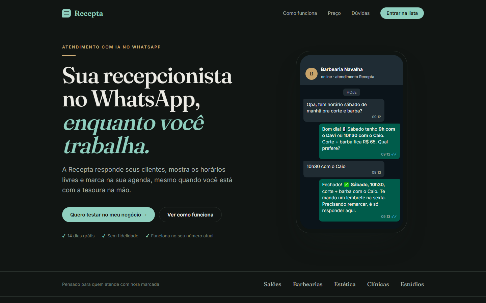

# Recepta: da Hipótese à Evidência

Case de **Product Discovery** e **validação de produto** com IA e métodos ágeis. Comecei querendo construir uma IA que atende o WhatsApp sozinha. A validação mostrou que os donos de pequenos negócios não querem uma IA falando por eles, e que a dor maior era outra: **as faltas dos clientes**. Decisão: **AJUSTAR**.

> Trabalho da disciplina **Metodologias Ágeis e Validação de Produtos**, UniFECAF, 2º semestre. Aluno: **Kennedy Pereira**.

---

## Índice

1. [Visão geral](#1-visão-geral)
2. [Links do projeto](#2-links-do-projeto)
3. [Problema](#3-problema)
4. [Hipóteses](#4-hipóteses-com-critério-definido-antes)
5. [Experimento](#5-experimento)
6. [Evidências e resultados](#6-evidências-e-resultados)
7. [Aprendizados](#7-aprendizados)
8. [Decisão: AJUSTAR](#8-decisão-ajustar)
9. [Prints](#9-prints)
10. [Entregáveis](#10-entregáveis)
11. [Organização dos arquivos](#11-organização-dos-arquivos)

---

## 1. Visão geral

| | |
|---|---|
| **Produto** | Recepta, recepcionista com IA no WhatsApp para negócios com hora marcada |
| **Público** | Estúdios, clínicas, profissionais autônomos e outros serviços com agendamento |
| **MVP de validação** | Landing page com conversa simulada + entrevistas + formulário estruturado |
| **Participantes** | 6 donos de pequenos negócios |
| **Resultado** | Problema e valor validados, solução refutada |
| **Decisão** | **Ajustar**: IA sugere e o dono aprova, com foco em reduzir faltas |



---

## 2. Links do projeto

- **Vídeo Pitch (YouTube):** https://youtu.be/EP8kXIexTGI
- **Repositório:** https://github.com/Kenny-Barra/recepta-validacao
- **Protótipo (landing page):** [prototipo/index.html](prototipo/index.html)
- **Parte teórica:** [docs/parte-teorica.md](docs/parte-teorica.md)
- **Síntese dos resultados:** [evidencias/sintese.md](evidencias/sintese.md)

---

## 3. Problema

Pequenos negócios de serviço com hora marcada (salão, barbearia, estética, clínica, estúdio) agendam quase tudo pelo WhatsApp, e quem responde é a mesma pessoa que atende. As mensagens se acumulam durante o atendimento, clientes novos desistem e o dono gasta o intervalo e a noite no celular.

---

## 4. Hipóteses (com critério definido antes)

| | Hipótese | Critério |
|---|---|---|
| H1 Problema | Não conseguem responder enquanto atendem e perdem tempo e clientes | ≥ 4 de 6 com dor ≥ 4 |
| H2 Solução | Aceitam uma IA respondendo e agendando **sozinha** | ≥ 4 de 6 "sim" |
| H3 Valor | Pagariam assinatura mensal | ≥ 3 pagam ≥ R$ 40 e ≥ 3 entram no piloto |

**Regra de decisão:** perseverar (H1, H2 e H3 validadas) · **ajustar (H1 e H3 sim, H2 não)** · pivotar (H3 não, ou problema só em outro segmento) · abandonar (H1 não).

---

## 5. Experimento

**Landing page com conversa simulada** + **entrevista de 15 a 20 minutos** + **formulário estruturado** com 6 potenciais usuários: estúdio de tatuagem, clínica de fisioterapia, professora particular de piano, lavanderia de bairro, fotógrafa de ensaios e clínica veterinária.

O protótipo mostra a proposta original, uma IA que responde e agenda sozinha, para medir a reação real a ela. Nada foi programado além da página.

---

## 6. Evidências e resultados

| Indicador | Resultado |
|---|---|
| Tempo médio respondendo mensagens | **1,6 h por dia** |
| Dor ≥ 4 | **4 de 6** |
| Aceitam IA respondendo sozinha | **2 de 6** |
| Pagariam ≥ R$ 40/mês | **4 de 6** (média de R$ 46) |
| Entraram no piloto | **4 de 6** |
| Citaram faltas **sem eu perguntar** | **5 de 6**, 7% dos atendimentos |

| Hipótese | Status |
|---|---|
| H1 Problema | ✅ Validada (no limite) |
| H2 Solução | ❌ Refutada |
| H3 Valor | ✅ Validada |

**Frases que resumem o aprendizado:**
- "Tatuagem é conversa. Uma IA não sabe dizer quanto custa." (P1, tatuagem)
- "Cada paciente que não vem é um fisioterapeuta parado 50 minutos." (P2, fisioterapia)
- "Os pais confiam em mim, não num sistema." (P3, aulas de piano)
- "O cliente deixa o saco de roupa e busca quando quiser." (P4, lavanderia)

---

## 7. Aprendizados

1. **O problema é real, mas a solução estava errada.** O dono vê a conversa com o cliente como parte do serviço. Uma IA autônoma é vista como risco à reputação, não como ajuda.
2. **A dor mais cara apareceu fora do roteiro.** Faltas foram citadas espontaneamente por 5 de 6. Se o experimento só confirmasse a ideia original, isso não teria aparecido.
3. **O público é mais estreito do que eu pensava.** Só serve para serviço com hora marcada e cliente presente. Lavanderia, onde o cliente deixa a roupa e busca depois, não tem o problema.
4. **A IA ajudou no processo, mas errou a previsão.** Ela previu boa aceitação da automação total, e as entrevistas mostraram o contrário.

---

## 8. Decisão: AJUSTAR

Pela regra definida antes do experimento: H1 e H3 validadas e H2 refutada significa **ajustar**. Mantenho o público e o modelo de assinatura e mudo a forma da solução:

| Antes | Depois |
|---|---|
| IA responde e agenda **sozinha** | IA **sugere** a resposta e o dono **aprova com um toque** |
| Foco: responder mensagens | Foco: **reduzir faltas** (confirmação 24 h antes + lista de espera) |
| Qualquer pequeno negócio | Só serviço com **hora marcada e cliente presente** |

**Próximo experimento (2 semanas):** *Concierge MVP* com os 4 voluntários do piloto. Eu mesmo envio as confirmações e lembretes pelo WhatsApp usando modelos gerados por IA, sem nenhum código.
**Critério para seguir:** queda de **≥ 30% nas faltas** e pelo menos **3 de 4** aceitando pagar R$ 49 ao final.

---

## 9. Prints

As imagens ficam em [prints/](prints/).

| # | Print | Imagem |
|---|---|---|
| 1 | Landing page com a conversa simulada da Recepta |  |

Para ver o protótipo funcionando, baixe o repositório e abra `prototipo/index.html` em qualquer navegador. O formulário é só demonstrativo e não envia dados.

---

## 10. Entregáveis

| Entregável | Onde |
|---|---|
| Parte Teórica (hipóteses e estratégia) | [docs/parte-teorica.md](docs/parte-teorica.md) (PDF enviado no AVA) |
| Canvas de produto (Lean Canvas + Proposta de Valor) | [docs/canvas.md](docs/canvas.md) |
| Protótipo (landing page) | [prototipo/index.html](prototipo/index.html) |
| Roteiro de entrevista e formulário | [evidencias/roteiro-entrevista.md](evidencias/roteiro-entrevista.md) |
| Registro das 6 entrevistas | [evidencias/entrevistas.md](evidencias/entrevistas.md) |
| Respostas do formulário (dados brutos) | [evidencias/respostas-formulario.csv](evidencias/respostas-formulario.csv) |
| Síntese, padrões e comparação | [evidencias/sintese.md](evidencias/sintese.md) |
| Uso da IA (prompts) | [docs/prompts-ia.md](docs/prompts-ia.md) |
| Vídeo Pitch (até 4 min) | https://youtu.be/EP8kXIexTGI |

---

## 11. Organização dos arquivos

```
recepta-validacao/
├── README.md                     ← este arquivo
├── docs/
│   ├── parte-teorica.md          ← Parte Teórica
│   ├── canvas.md                 ← Lean Canvas + Proposta de Valor
│   └── prompts-ia.md             ← prompts usados com a IA
├── evidencias/
│   ├── roteiro-entrevista.md     ← roteiro e formulário
│   ├── entrevistas.md            ← registro das 6 entrevistas
│   ├── respostas-formulario.csv  ← dados brutos
│   └── sintese.md                ← números, mapa de afinidade e decisão
├── prototipo/
│   └── index.html                ← landing page (MVP de validação)
└── prints/                       ← prints do protótipo
```
